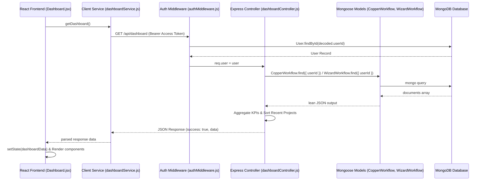

# Kora LCA Platform Architecture

This document describes the technical architecture and technology stack of the Kora Circular Economy & Life Cycle Assessment (LCA) application.

## 1. Technology Stack

### Frontend
- **Core Library**: React (Vite-based build tool)
- **Routing**: React Router DOM (v6, declarative `createBrowserRouter`)
- **State Management**: React state hooks (`useState`, `useEffect`, `useContext`) and localStorage/sessionStorage caching
- **UI Design System**: Vanilla CSS with curated variables conforming to the Royal Mineral Visual Design System (Dark/Neutral surfaces, Champagne Gold premium highlights, Copper metallurgy, Amethyst AI, Jade circularity)
- **Visualization/Flows**: React Flow (for process canvas drag-and-drop workflow modeling) and custom SVG charts

### Backend
- **Core Platform**: Node.js & Express
- **Database Wrapper**: Mongoose ODM (MongoDB object modeling)
- **Authentication**: JSON Web Tokens (JWT) for stateless session handling, bcryptjs for password hashing
- **Middleware**: Helmet (security headers), CORS, Compression, rate-limiting, custom request sanitizers
- **AI Integration**: Custom Fallback AI generator & prediction engine

### Database
- **Primary Database**: MongoDB (embedded development instance / production-ready)

---

## 2. Main Application Modules

### 1. Authentication & Security
- stateless JWT architecture (access and refresh token cycle stored in `sessionStorage` on client-side)
- sanitization middleware intercepting all requests to block MongoDB operator injection and cross-site scripting (XSS)

### 2. Multi-Step LCA Wizard (`Wizard.jsx`, `wizardForm-cu.jsx`)
- Multi-step forms for data input across lifecycle stages:
  1. Mining
  2. Beneficiation
  3. Refining/Smelting
  4. Manufacturing
  5. Use Phase
  6. Recycling
  7. Valorization
- Dedicated wizard workflows for metals: Copper (`CopperWorkflow`), Aluminium (`WizardWorkflow`), Steel (`SteelWorkflow`), Zinc (`WizardWorkflow`), and Lead (`WizardWorkflow`)
- Integrated AI predictions that auto-complete empty fields with confidence scores using the Gemini-derived fallback engine

### 3. Interactive Process Canvas (`ProcessCanvas.jsx`)
- Powered by React Flow
- Interactive node-based mapping of smelting, refining, and recycling steps
- Live updating of node parameters and circular loop feedback computations

### 4. LCA Calculation Engine & Reports
- Core calculation pipelines computing Global Warming Potential (GWP), circularity scores, and energy/water consumption indices
- Rich PDF report export using server-side formatting

### 5. Live Dashboard
- Unified view summarizing project counts, average circularity index, and cumulative carbon savings
- Aggregates multi-model state across all workflow types (`CopperWorkflow`, `WizardWorkflow`, `Project`) for real-time reporting

---

## 3. Data Flow

---

## 4. Key Configurations & Ports
- **Frontend Port**: 5173 (Vite default server)
- **Backend Port**: 5001 (configured in `.env`)
- **Database URL**: `mongodb://localhost:27017/sih69`
- **Environment**: Development / Production
