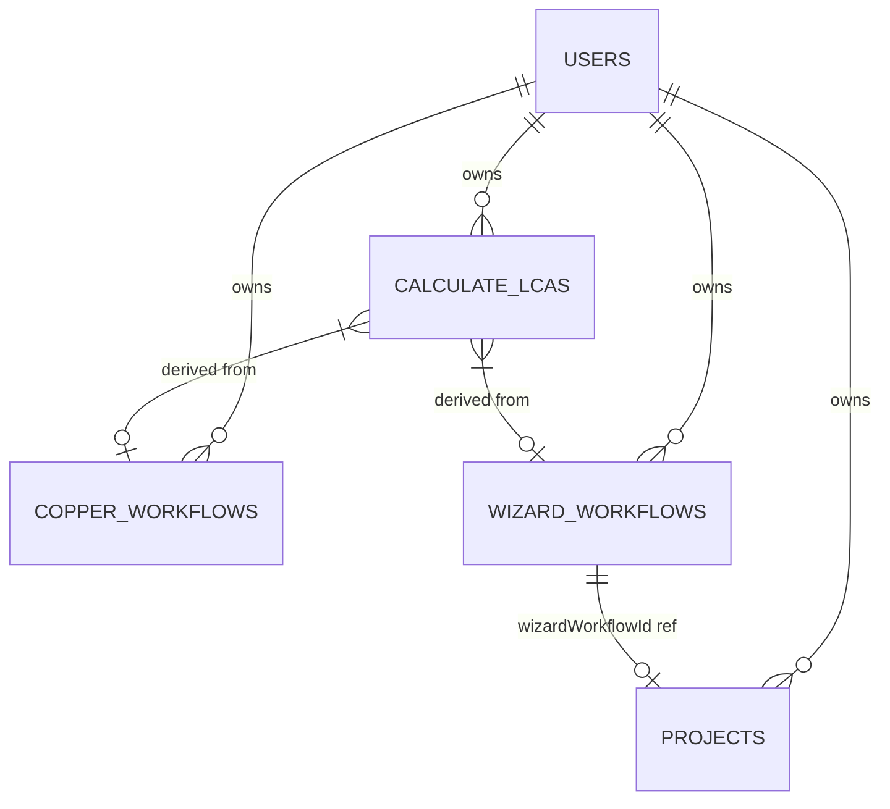

# Kora LCA Platform Data Model

This document outlines the database models, relationships, API data shapes, and the origin of application data.

## 1. Database Collections & Models (Mongoose)

### 1. `users` (User Model)
Represents registered users in the platform.
- `_id`: ObjectId (Primary Key)
- `name`: String (Required)
- `email`: String (Required, Unique, Lowercase)
- `organization`: String (Required)
- `password`: String (Required, Hashed, `select: false` by default)
- `createdAt` / `updatedAt`: Date (Auto-generated by Mongoose timestamps)

### 2. `copperworkflows` (CopperWorkflow Model)
Stores multi-stage data specifically collected during the Copper LCA wizard process.
- `_id`: ObjectId (Primary Key)
- `name`: String (Required)
- `description`: String
- `userId`: ObjectId (Ref: `User`, Index)
- `metalType`: String (Default: 'Copper')
- `completionPercentage`: Number (0-100)
- `status`: String (Enum: `'draft'`, `'in_progress'`, `'submitted'`, `'completed'`, Default: `'draft'`)
- Stage-wise Embedded Subdocuments:
  - `copperMining`: Inputs/outputs for copper ore excavation
  - `copperBeneficiation`: Milling, flotation reagents, tailings details
  - `copperRefining`: Smelting details, scrap charging, cathode output
  - `manufacturing`: Casting/forming parameters
  - `usePhase`: Equipment lifespan and operational logs
  - `recycling`: Collection efficiency and sorting recovery rates
  - `valorization`: Slag utilization and precious metal recovery metrics
- `calculatedResults`: Embedded summary metrics (circularityScore, GWP/CO2 saved, etc.)

### 3. `wizardworkflows` (WizardWorkflow Model)
General multi-stage wizard data collection schema for non-copper metals (e.g. Aluminium, Steel, Zinc, Lead).
- `_id`: ObjectId (Primary Key)
- `name`: String (Required)
- `userId`: ObjectId (Ref: `User`, Index)
- `metalType`: String (Enum: `'Aluminium'`, `'Steel'`, `'Lead'`, `'Zinc'`, `'Nickel'`)
- `status`: String (Enum: `'draft'`, `'in-progress'`, `'submitted'`, `'completed'`, Default: `'draft'`)
- `completionPercentage`: Number (0-100)
- Stage-wise Embedded Data:
  - `mining`, `beneficiation`, `refining`, `smelting`, `manufacturing`, `recycling`, `valorization`
- `calculatedResults`: Aggregate LCA results and circularity indices

### 4. `projects` (Project Model)
Legacy project schema kept for backward compatibility and general ad-hoc smelting assessments.
- `_id`: ObjectId
- `name`: String
- `metalType`: String
- `processType`: String
- `circularityScore`: Number
- `gwp`: Number
- `gwpSaved`: Number
- `userId`: ObjectId (Ref: `User`, Index)
- `status`: String (Enum: `'draft'`, `'in-progress'`, `'completed'`, `'archived'`, Default: `'draft'`)

### 5. `calculatelcas` (CalculateLCA Model)
Stores computed results and links generated reports (PDF) for direct visualization.
- `_id`: ObjectId
- `userId`: ObjectId (Ref: `User`)
- `projectName`: String
- `location`: String
- `circularityScore`: Number
- `totalCO2Emissions`: Number
- `totalEnergyConsumed`: Number
- `totalWaterUsed`: Number
- `totalWasteGenerated`: Number
- `lcaStages`: Array of stage objects (mining, beneficiation, etc.) containing:
  - `energyConsumption`, `co2Emissions`, `waterUsage`, `wasteGenerated`
- `pdfUrl`: String (Path to generated PDF file)

---

## 2. Model Relationships

---

## 3. Data Origin & Mock/Hardcoded Logic

### Live (Real) Application Data
- **User Authentication**: Handled via MongoDB queries on `users` collection.
- **Workflow State & Inputs**: Multi-step wizard saves step-by-step forms directly to `copperworkflows` and `wizardworkflows`.
- **Dashboard Counts & Recents**: Aggregated live counts from `copperworkflows`, `wizardworkflows`, and `projects`.
- **LCA Reports & Stage Breakdown**: Results computed dynamically by `lcaController.js` and stored in `calculatelcas`.

### Mock / Seeded / Hardcoded Fallbacks
- **Dashboard Industry Trends & Benchmarks**:
  - `getIndustryInsights()` and `generateMockBenchmark()` provide standard industry indicators (e.g. median sector performance, regional benchmarks) since they are global metrics rather than user-owned.
- **Wizard Initial Step Templates**:
  - Fallback defaults for wizard fields are populated via client-side configuration constants when a user starts a step without entering custom values.
- **Fallback AI Generator**:
  - If the external LLM is offline or no API key is set, the fallback generator (`aiFallbackGenerator.js`) uses rule-based estimation templates to complete workflow steps.
